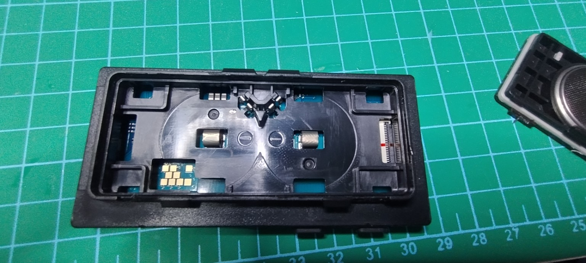
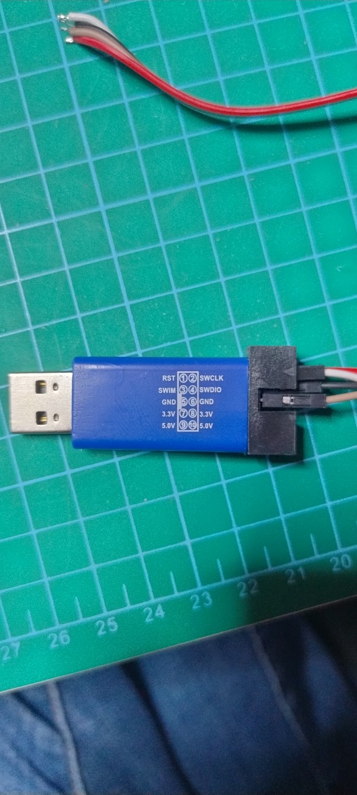
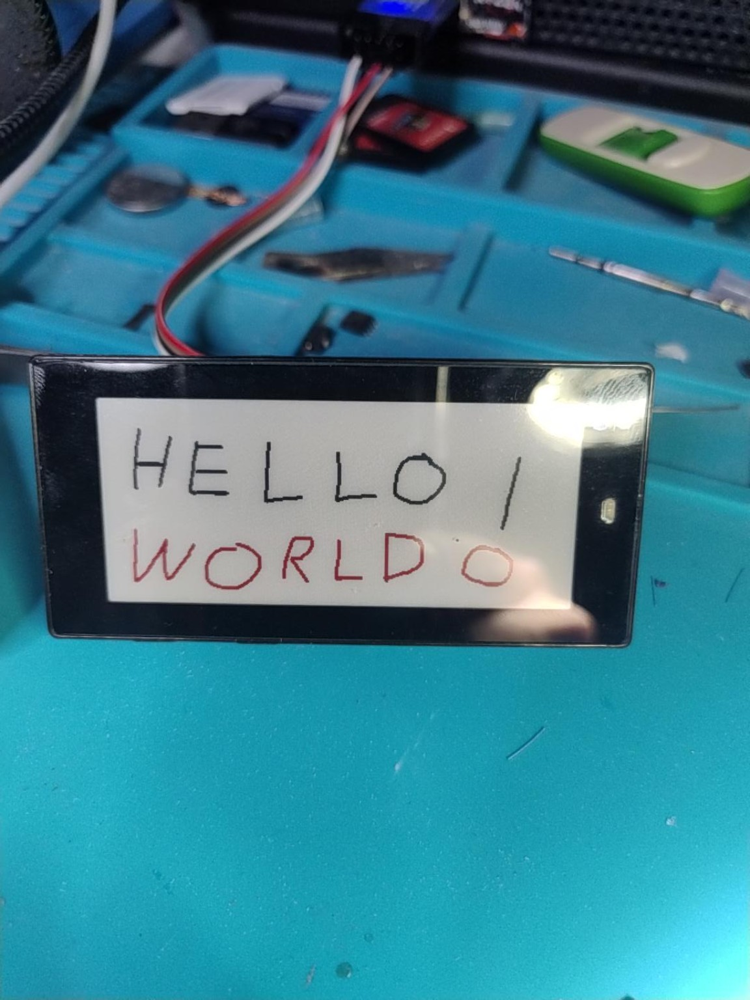

# Deutsche Anleitung

[English](README.en.md) · [Projektübersicht](../README.md)

Diese Anleitung beschreibt den erfolgreich getesteten Umbau eines **SOLUM EL029H3BRA, Newton M3, 2,9 Zoll** auf Bluetooth. Der Controller muss ein **nRF52811** sein. Das getestete Panel verwendet die SSD-Controllerkennung `0x15`, hat **384 × 168 Pixel** im Querformat und zeigt Schwarz, Weiß und Rot. Andere Chargen können abweichen.

## 1. Was du brauchst

- Ein passendes, eigenes SOLUM-Preisschild.
- ST-Link V2 mit Firmware ab V2J24 und direktem DAP-Zugriff; getestet: blauer Klon mit V2J37S7.
- Windows-PC, Bluetooth und Chrome oder Edge; ein funktionierender BLE-Adapter ist erforderlich.
- OpenOCD **0.12.0-1** aus den [xPack-Releases](https://github.com/xpack-dev-tools/openocd-xpack/releases/tag/v0.12.0-1), Windows-x64-ZIP vollständig entpacken.
- Bei Bedarf den [offiziellen ST-Link-USB-Treiber](https://www.st.com/en/development-tools/stsw-link009.html).
- Kurze Leitungen bzw. Federkontakte und ein Multimeter.

Du brauchst **keinen zusätzlichen ESP32-Access-Point**. Der ST-Link wird zum Programmieren verwendet, Bilder werden später per Bluetooth übertragen. Beim getesteten Weg ist kein Bluetooth-OTA-Bootloader installiert; Firmwareupdates erfolgen weiter per ST-Link.

## 2. Kontakte und Versorgung



Die Tabelle gilt für diese Fotoausrichtung: Batteriefach nach oben, Kontaktgruppe unten links. Oben sind drei Pads mit einer Lücke vor dem rechten Pad, in der Mitte zwei versetzte Pads, unten vier Pads.

| Pad am Schild | Signal | ST-Link laut abgebildetem Gehäuse |
|---|---|---|
| Oben rechts, einzeln | VCC | Pin 7 oder 8, **3,3 V** |
| Mitte links | SWDIO | Pin 4 |
| Mitte rechts | SWCLK | Pin 2 |
| Unten ganz rechts | GND | Pin 5 oder 6 |
| Unten drittes Pad von links | nRESET | Beim getesteten Klon unbeschaltet |



**Batterien entfernen. Vor dem Anschließen Masse und VCC mit dem Multimeter prüfen. Niemals die 5-V-Pins benutzen.** Die Versorgungspins und Belegungen von ST-Link-Klonen können abweichen. Manche Debugger haben nur einen Spannungserkennungseingang und versorgen das Ziel nicht selbst. Der mit RST beschriftete Pin eines Klons ist nicht automatisch ein nutzbarer ARM-NRST-Ausgang.

## 3. Chip identifizieren und Original sichern

Öffne PowerShell im OpenOCD-`bin`-Ordner. Alle folgenden relativen Pfade beziehen sich darauf. Separate `-c`-Argumente sind hier absichtlich gewählt: Mit zusammengefassten Befehlen fehlte im getesteten Windows-Aufruf die Registerausgabe.

```powershell
.\openocd.exe -s ..\scripts -f interface/stlink-dap.cfg -c "transport select dapdirect_swd" -f target/nrf52.cfg -c "adapter speed 100" -c "init" -c "mdw 0x10000100 5" -c "shutdown"
```

Beim getesteten Chip lautete die Zeile:

```text
0x10000100: 00052811 41414130 00002000 00000018 000000c0
```

Das bestätigt nRF52811, 24 KiB RAM und 192 KiB Flash. Bei einem anderen Chip, einer Zugriffssperre oder Fehlern **nicht blind mit diesen Flashbefehlen fortfahren**. `nrf52_recover` löscht das Gerät einschließlich UICR und ist hier nicht nötig.

```powershell
New-Item -ItemType Directory -Force .\display-backup | Out-Null
.\openocd.exe -s ..\scripts -f interface/stlink-dap.cfg -c "transport select dapdirect_swd" -f target/nrf52.cfg -c "adapter speed 100" -c "init" -c "halt" -c "dump_image display-backup/original-flash.bin 0x00000000 0x30000" -c "dump_image display-backup/original-uicr.bin 0x10001000 0x1000" -c "resume" -c "shutdown"
Get-ChildItem .\display-backup | Select-Object Name,Length
```

Erwartete Größen: `original-flash.bin` **196608 Byte**, `original-uicr.bin` **4096 Byte**. Diese Dateien privat aufbewahren. Das ist eine Sicherung des internen Controllers, nicht des separaten SPI-Flashs; ein vollständiger Werkszustand ist damit nicht zugesichert.

## 4. Bluetooth-Basis installieren — nur beim ersten Wechsel

Die vollständige Erstinstallation benötigt den Bluetooth-Stack. Lade die **unveränderte OpenDisplay-1.4-`sd.hex`** herunter:

```powershell
Invoke-WebRequest -Uri "https://github.com/OpenDisplay/Firmware_NRF/releases/download/1.4/EPD-nRF52-v1.4-sd.hex" -OutFile ".\OpenDisplay-v1.4-sd.hex"
if ((Get-FileHash .\OpenDisplay-v1.4-sd.hex -Algorithm SHA256).Hash -ne "01DCE87BC5C8E49B289A2D84D3537F4E8B7B9D377D47892786770598E5758F2C") { throw "Falsche oder veränderte Basisdatei" }
```

**Der nächste Befehl löscht den gesamten internen Programm-Flash und bestehende OpenDisplay-Einstellungen. UICR wird nicht gelöscht. Nur zur Erstinstallation nach erfolgreicher Sicherung verwenden.**

```powershell
.\openocd.exe -s ..\scripts -f interface/stlink-dap.cfg -c "transport select dapdirect_swd" -f target/nrf52.cfg -c "adapter speed 100" -c "init" -c "reset init" -c "flash erase_sector 0 0 last" -c "flash write_image OpenDisplay-v1.4-sd.hex 0 ihex" -c "verify_image OpenDisplay-v1.4-sd.hex 0 ihex" -c "verify_image display-backup/original-uicr.bin 0x10001000 bin" -c "reset run" -c "shutdown"
```

Bei Fehlern erst die Ursache klären. UICR darf nicht durch einen fremden Dump ersetzt werden.

## 5. Getestete Panel-Korrektur installieren

Kopiere [`OpenDisplay-v1.4-panel-fix.hex`](../firmware/OpenDisplay-v1.4-panel-fix.hex) in den `bin`-Ordner. **Diese Anwendung benötigt die Basis aus Schritt 4.**

```powershell
.\openocd.exe -s ..\scripts -f interface/stlink-dap.cfg -c "transport select dapdirect_swd" -f target/nrf52.cfg -c "adapter speed 100" -c "program OpenDisplay-v1.4-panel-fix.hex verify reset exit"
```

OpenOCD muss `Verified OK` melden. **Keine zusätzliche Massenlöschung ausführen.** Dieser Aktualisierungsschritt berührt nur die Anwendungsseiten bis `0x26FFF`, nicht UICR oder die Konfigurationsseiten am Flashende.

## 6. Bluetooth-Konfiguration laden

1. Bluetooth einschalten und die [OpenDisplay-Toolbox im Editor-Modus](https://opendisplay.org/firmware/toolbox/index.html?mode=edit) öffnen.
2. Mit dem Schild verbinden. Der Name beginnt mit **OD**, ist aber für jedes Gerät anders.
3. **Import JSON** → [`solum-m3-29-ssd1619.json`](../config/solum-m3-29-ssd1619.json).
4. **Write to device**. Danach trennen und die Versorgung kurz unterbrechen.
5. Den [Bildtester](https://opendisplay.org/firmware/display/index.html) öffnen, verbinden und ein Bild senden.

Der Preset enthält System, Manufacturer, Power, Display, LED und Taster. Die Übertragung umfasst **189 Byte**, liegt unter dem **512-Byte-Limit** der Firmware und enthält keinen Encryption-Block. Das ist die in dieser Sitzung erfolgreich verwendete unverschlüsselte Betriebsart. Sie verlangt keinen Schlüssel zur Steuerung in BLE-Reichweite.

Wichtige Displaywerte: **SSD1619 2.9″ B/W/R**, Panel-ID **1016**, **168 × 384**, MOSI **20**, SCLK **19**, CS **6**, DC **5**, RESET **4**, BUSY **3**, Power-Pin **7**, Direct Write aktiviert. Der Controller arbeitet im Hochformat; nutze für Querformat die Rotation im Bildtester und sende anschließend neu.

Für die erste Einrichtung darf die Toolbox-Konfiguration nicht fehlen: Ein leerer Speicher konnte als „Couldn't read its settings“ erscheinen. Alternativ führt „Install OpenDisplay over USB“ → „The firmware is already installed“ zum Einrichtungsassistenten. Die Firmware ist bereits per ST-Link installiert; der Browser muss sie nicht erneut flashen.

## 7. Ergebnis prüfen

Sende ein weißes Bild mit schwarzem Text, rotem Text und asymmetrischen Markierungen links und rechts. Weiß muss weiß bleiben, Rot rot und Schrift lesbar. Vergleiche mit dem bestätigten Ergebnis:



## Fehlerbehebung

| Symptom | In dieser Sitzung beobachtete Ursache / Vorgehen |
|---|---|
| `No AP Found` | Noch OpenEPaperLink-Firmware aktiv. Diese sucht einen OEPL-AP; Bluetooth-Firmware installieren. |
| `Config write failed`, 545 Byte | Mehr als 512 Byte. Den gesamten Block **Names and strings** entfernen, nicht nur seine Felder leeren. |
| `No display config found` | Display-Block fehlt, oder verschlüsselte Daten wurden falsch interpretiert. Erst Log und exportierte JSON prüfen. |
| Schlüsselabfrage / unsinnige Chunk-Nummern | Im getesteten Web-Workflow gab es Probleme mit Encryption. Im Editor Encryption-Block entfernen, schreiben, komplett stromlos neu starten. |
| Hintergrund rot, später Schwarz/Weiß vertauscht | Passende Panel-Korrektur installieren; nicht einfach ein anderes Panel wählen. |
| Schrift gespiegelt | Panel-Korrektur enthält aufsteigende Y-Adressierung. Rotation ist kein Ersatz für Spiegelung. |
| `MSD read timeout` | Nicht allein als Beweis einer defekten Bildübertragung werten. Maßgeblich sind gelesene Displaykonfiguration und tatsächliches Bild. |
| Altes Bild bleibt nach Stromausfall sichtbar | Normales E-Ink-Verhalten; erst die nächste Aktualisierung ändert das Bild. |

Ein späteres offizielles Firmwareupdate kann diese lokale Panel-Korrektur überschreiben. Vor Updates den aktuellen JSON-Preset und die funktionierende HEX sichern. Die generische Toolbox-Bezeichnung kann aus den aktiven Millimetermaßen eine andere Zollangabe berechnen; entscheidend sind bestätigter Controller und Pixelzahl.

## Entwickeln und reproduzieren

Siehe [technische Hinweise](TECHNICAL.md). Die exakt getestete Datei lässt sich aus dem geprüften upstream HEX mit Python ohne Zusatzpakete reproduzieren. Das Quellarchiv und die Änderungen liegen unter `source/`. Ubuntu/OpenOCD ist prinzipiell ebenfalls verwendbar; die vollständige End-to-End-Prüfung dieser Anleitung erfolgte unter Windows.
