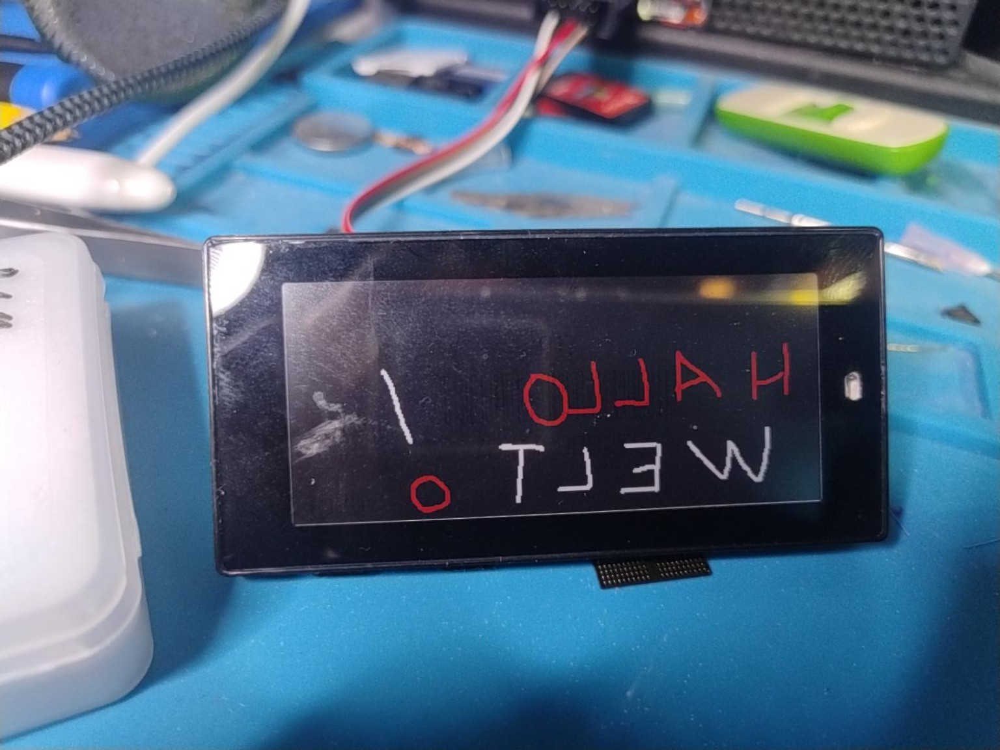

# Technical notes / Technische Hinweise

## Exact base

- Upstream: <https://github.com/OpenDisplay/Firmware_NRF>
- Release: **1.4**
- Source commit: **`71b870c12855b2bab4db11fdf1fb213818f3f3a8`**
- Input: `EPD-nRF52-v1.4-sd.hex`
- Input SHA256: `01dce87bc5c8e49b289a2d84d3537f4e8b7b9d377d47892786770598e5758f2c`

## Reproduce the exact tested application

Python 3.10+ is sufficient; no third-party packages are needed:

```sh
python scripts/patch_firmware.py --download --output reproduced.hex --compare firmware/OpenDisplay-v1.4-panel-fix.hex
python -m unittest discover -s tests -v
```

Or use a previously downloaded upstream file with `--input path/to/EPD-nRF52-v1.4-sd.hex`. The script rejects any other SHA256, verifies Intel HEX checksums, checks the original instruction bytes, applies exactly three changes and exports only the application. HEX text formatting may differ; `--compare` compares all address/data bytes rather than line formatting.

## Actual binary changes

| Address in upstream image | Before | After | Meaning |
|---|---|---|---|
| `0x1E996` | `11 2A` | `0F 2A` | `cmp r2,#17` → `cmp r2,#15`; includes model IDs 16/17 in the ascending-Y branch |
| `0x1EB20` | `08 23` | `80 23` | BWR display-update control in refresh |
| `0x1EBC8` | `08 23` | `80 23` | BWR display-update control in init |

The SSD1619 command `0x21` uses the upper nibble for red RAM interpretation and the lower nibble for B/W RAM interpretation. Nibble value `8` inverts that plane. Thus `0x08` inverts BW, while the tested panel needs `0x80`: normal BW and inverted red interpretation. Reference: [SSD1619A specification](https://www.e-paper-display.com/SSD1619ASpecification.pdf), Display Update Control 1, printed page 25.

The source-equivalent change is in [panel-fix.patch](../source/panel-fix.patch). The BWR constant change affects the shared SSD16xx driver, so do not assume it is correct for other panel models. The Y-direction change is limited to the 2.9″ SSD1619 model IDs.

## Validation and hardware evidence

- ARM Thumb disassembly checked both modified BWR immediate instructions and the addressing comparison.
- The actual `SSD16xx_SetWindow` machine code was emulated during preparation: model 17 switched from entry mode `0x01` to `0x03`, Y start `383` to `0`, and Y window to ascending `0..383`. The 8-pixel X offset was preserved. Representative model 18 and 20 paths were unchanged.
- The owner physically tested the application: white background, black and red text, no horizontal reflection; see the photos.
- No claim of battery-life measurement, every model's compatibility, encrypted web-workflow reliability, OTA support or complete factory restoration is made.
- The original end-to-end session first used OEPL to verify the panel. The documented direct first-install route is derived from the same confirmed BLE installation steps; it is not a second independently tested factory label.

## Flash layout

| Region | Used here |
|---|---|
| `0x00000..0x18FFF` | Existing SoftDevice S112 7.3.0; not included in our HEX |
| `0x19000..0x26F77` | Tested application HEX |
| Through `0x26FFF` | Last application page erased by an ordinary `program` operation |
| Flash-end FDS pages | Outside the application update range; initial full-bank erase removes their contents |
| `0x10001000..0x10001FFF` | UICR; preserve the device's own data |

## Source availability and rebuilding from C

The included source archive contains upstream release 1.4 with the source-equivalent `EPD/SSD16xx.c` changes, build files, SDK sources and original license notices. The upstream publicly committed example `tools/priv.pem` signing key is intentionally omitted: it is not needed for the application-only / `make sd` build. We do not distribute an OTA signing key or a signed OTA package.

Extract `source/OpenDisplay-NRF-1.4-panel-fix-source.tar.gz`, then follow `build-nrf52/README.md`. In short, install ARM GCC, run `make app` from `build-nrf52`, and use the provided upstream merge route only if a combined SoftDevice image is needed. Building from C is source-equivalent, but is **not claimed byte-identical** to the tested binary: compiler versions and flags can differ. The deterministic HEX patch script reproduces the tested bytes.

## Preset compatibility

The JSON uses the current Toolbox schema's fixed-size packets. It deliberately excludes the 284-byte `data_extended` / Names and strings packet and the 64-byte Security packet. Total serialized size, including headers and CRC: **189 bytes**. Keep Power and Display when editing. Do not confuse the schema's panel ID `1016` with its color-scheme ID `1`, or with the driver's internal BWR enum `2`.

## Before and after




